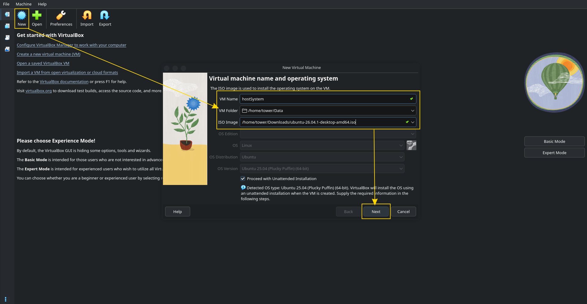
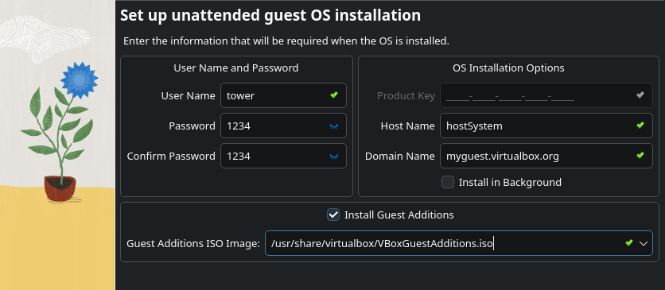
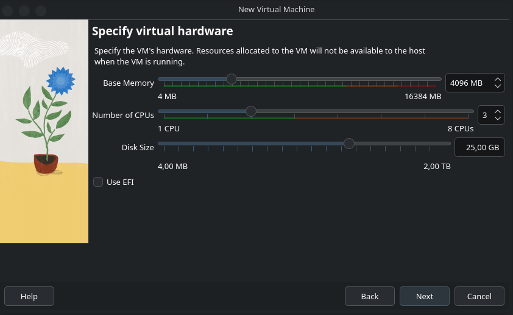
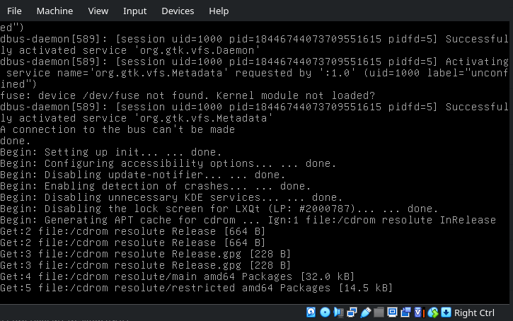
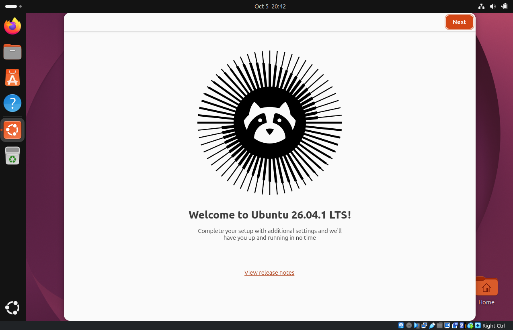
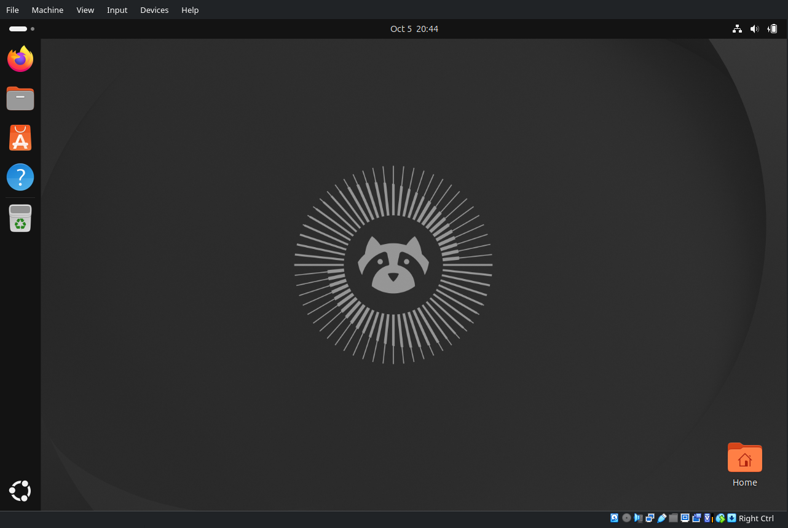
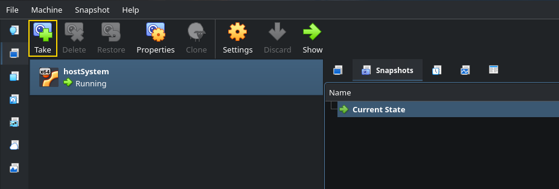

# Creating the Host System

## Set Up the Host System

To build `Linux From Scratch`, you need a host system. I chose [Ubuntu Desktop](https://ubuntu.com/download/desktop), but you can use **any** Linux distribution.

---

### Create the Virtual Machine

> I used `virtualbox-7.2_7.2.20` with `Debian 13.6`.

  

---

> Choose an easy-to-remember password.

  

---

> Choose the amount of RAM, CPU, and disk space according to your computer's resources.

  

---

> Let Ubuntu start.

  

---

> These settings are up to you.

  

---

> The host system is now installed and ready to use.

  

---

---

> Save this state as a snapshot. Otherwise, you can restore the machine to this point with `Host + T`.

  

