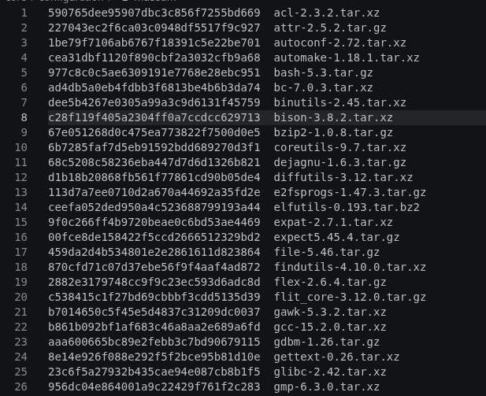

# Installing Source Packages

## Downloading Sources

Create a directory to store the source packages.

```bash
sudo mkdir -v $LFS/sources 
```

Set the sticky bit on the directory.

> [!NOTE]
> A sticky directory is a shared directory on a Unix-like system where only the file owner, the directory owner, or the root user can delete or rename files.
```bash
sudo chmod -v a+wt $LFS/sources
```

Download the file containing the links to all LFS sources.

> [!CAUTION]
> The original `wget-list-sysv` contain a deprecated link of `ncurses-6.5-20250809`.
> This reddit gave an alternative : [r/linuxfromscratch](https://www.reddit.com/r/linuxfromscratch/comments/1tadaqd/quick_solution_for_ncurses6520250809tgz_404/?tl=fr)  


I recommend you to download the file from my git where i changed the deprecated ncurses link. 
```bash
sudo wget "https://raw.githubusercontent.com/ftTower/ft_linux/refs/heads/main/configuration/wget-sysv-list" -P $LFS/sources/
```

Use the list to download all source packages with `wget` into `$LFS/sources`.
```bash
sudo wget --input-file=$LFS/sources/wget-list-sysv --continue --directory-prefix=$LFS/sources
```

<div align="center">
  
</div>

This file lists the checksums alongside the package names. We will use it to verify that each downloaded file matches the version provided by the LFS project.
```bash
sudo wget https://www.linuxfromscratch.org/lfs/view/stable/md5sums -P $LFS/sources/
```

The following command uses this file to verify the checksums.
> [!NOTE]
> This confirms that the source files were not corrupted during the download.

```bash
pushd $LFS/sources
  md5sum -c md5sums
popd
```

## Next: [Create the LFS Environment and First User](./lfsenvironnement.md)
