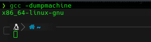
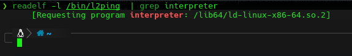

# Cross-Compiling the Toolchain

## Preliminary Information

> [!NOTE]
> These screenshots were taken on my personal computer.

<div align="center">
  
</div>

```bash
gcc -dumpmachine
```

<br>

<div align="center">
  
</div>

```bash
readelf -l <name of binary> | grep interpreter
```

- [Toolchain Technical Notes](https://www.linuxfromscratch.org/lfs/view/stable/partintro/toolchaintechnotes.html)


## Compilation Instructions

> [!NOTE]
> Do not use the `root` user. Use the `lfs` user.
> Compile all packages in a directory that is accessible from the chroot environment, such as `$LFS`.
> The compilation steps differ between packages. Follow the LFS book for each package.

To compile a source package:

1. Extract the archive with `tar -xf <package>.tar.gz`.
2. Enter the extracted directory with `cd <package>`.
3. Follow the package-specific compilation instructions.
4. Return to the sources directory with `cd $LFS/sources`.
5. Remove the extracted directory with `rm -rf <package>`.

## Cross-Toolchain Components

1. [Compile binutils](https://www.linuxfromscratch.org/lfs/view/stable/chapter05/binutils-pass1.html)
2. [Compile cross GCC](https://www.linuxfromscratch.org/lfs/view/stable/chapter05/gcc-pass1.html)
3. [Install the Linux API headers](https://www.linuxfromscratch.org/lfs/view/stable/chapter05/linux-headers.html)
4. [Compile Glibc](https://www.linuxfromscratch.org/lfs/view/stable/chapter05/glibc.html)
5. [Compile libstdc++](https://www.linuxfromscratch.org/lfs/view/stable/chapter05/gcc-libstdc++.html)

<br><br><br>

# Next: [Cross-Compile the Temporary Tools](./temptools.md)