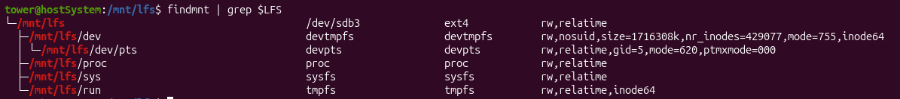

# Entering Chroot and Building Additional Temporary Tools

## Changing Ownership

```bash
sudo chown --from lfs -R root:root $LFS/{usr,var,etc,tools}
case $(uname -m) in
  x86_64) sudo chown --from lfs -R root:root $LFS/lib64 ;;
esac
```

## Preparing Virtual Kernel File Systems

```bash
mkdir -pv $LFS/{dev,proc,sys,run}
```

```bash
sudo mount -v --bind /dev $LFS/dev
```

## Mounting Virtual Kernel File Systems

```bash
mount -vt devpts devpts -o gid=5,mode=0620 $LFS/dev/pts
```

```bash
sudo mount -vt proc proc $LFS/proc
```

```bash
sudo mount -vt sysfs sysfs $LFS/sys
```

```bash
sudo mount -vt tmpfs tmpfs $LFS/run
```

---

> In some host systems, /dev/shm is a symbolic link to a directory, typically /run/shm. The /run tmpfs was mounted above so in this case only a directory needs to be created with the correct permissions.

> In other host systems /dev/shm is a mount point for a tmpfs. In that case the mount of /dev above will only create /dev/shm as a directory in the chroot environment. In this situation we must explicitly mount a tmpfs:

---

My system was in mount point case

```bash
if [ -h $LFS/dev/shm ]; then
  sudo install -v -d -m 1777 $LFS$(realpath /dev/shm)
else
  sudo mount -vt tmpfs -o nosuid,nodev tmpfs $LFS/dev/shm # 
fi
```

## Entering the Chroot Environment

```bash
sudo chroot "$LFS" /usr/bin/env -i   \
    HOME=/root                  \
    TERM="$TERM"                \
    PS1='(lfs chroot) \u:\w\$ ' \
    PATH=/usr/bin:/usr/sbin     \
    MAKEFLAGS="-j$(nproc)"      \
    TESTSUITEFLAGS="-j$(nproc)" \
    /bin/bash --login
```

##

```bash
mkdir -pv /{boot,home,mnt,opt,srv}
```

```bash
mkdir -pv /etc/{opt,sysconfig}
mkdir -pv /lib/firmware
mkdir -pv /media/{floppy,cdrom}
mkdir -pv /usr/{,local/}{include,src}
mkdir -pv /usr/lib/locale
mkdir -pv /usr/local/{bin,lib,sbin}
mkdir -pv /usr/{,local/}share/{color,dict,doc,info,locale,man}
mkdir -pv /usr/{,local/}share/{misc,terminfo,zoneinfo}
mkdir -pv /usr/{,local/}share/man/man{1..8}
mkdir -pv /var/{cache,local,log,mail,opt,spool}
mkdir -pv /var/lib/{color,misc,locate}

ln -sfv /run /var/run
ln -sfv /run/lock /var/lock

install -dv -m 0750 /root
install -dv -m 1777 /tmp /var/tmp
```

## Creating Essential Files and Symlinks

```bash
ln -sv /proc/self/mounts /etc/mtab
```

```bash
cat > /etc/hosts << EOF
127.0.0.1  localhost $(hostname)
::1        localhost
EOF
```

```bash
cat > /etc/passwd << "EOF"
root:x:0:0:root:/root:/bin/bash
bin:x:1:1:bin:/dev/null:/usr/bin/false
daemon:x:6:6:Daemon User:/dev/null:/usr/bin/false
messagebus:x:18:18:D-Bus Message Daemon User:/run/dbus:/usr/bin/false
uuidd:x:80:80:UUID Generation Daemon User:/dev/null:/usr/bin/false
nobody:x:65534:65534:Unprivileged User:/dev/null:/usr/bin/false
EOF
```

```bash
cat > /etc/group << "EOF"
root:x:0:
bin:x:1:daemon
sys:x:2:
kmem:x:3:
tape:x:4:
tty:x:5:
daemon:x:6:
floppy:x:7:
disk:x:8:
lp:x:9:
dialout:x:10:
audio:x:11:
video:x:12:
utmp:x:13:
cdrom:x:15:
adm:x:16:
messagebus:x:18:
input:x:24:
mail:x:34:
kvm:x:61:
uuidd:x:80:
wheel:x:97:
users:x:999:
nogroup:x:65534:
EOF
```

```bash
echo "tester:x:101:101::/home/tester:/bin/bash" >> /etc/passwd
echo "tester:x:101:" >> /etc/group
install -o tester -d /home/tester
```

```bash
exec /usr/bin/bash --login
```

```bash
touch /var/log/{btmp,lastlog,faillog,wtmp}
chgrp -v utmp /var/log/lastlog
chmod -v 664  /var/log/lastlog
chmod -v 600  /var/log/btmp
```

> The /var/log/wtmp file records all logins and logouts. The /var/log/lastlog file records when each user last logged in. The /var/log/faillog file records failed login attempts. The /var/log/btmp file records the bad login attempts.

> The /run/utmp file records the users that are currently logged in. This file is created dynamically in the boot scripts.

## Installing more packages

1. [Gettext](https://www.linuxfromscratch.org/lfs/view/stable/chapter07/gettext.html)
2. [Bison](https://www.linuxfromscratch.org/lfs/view/stable/chapter07/bison.html)
3. [Pearl](https://www.linuxfromscratch.org/lfs/view/stable/chapter07/perl.html)
4. [Python](https://www.linuxfromscratch.org/lfs/view/stable/chapter07/Python.html)
5. [Texinfo](https://www.linuxfromscratch.org/lfs/view/stable/chapter07/texinfo.html)
6. [Util-linux](https://www.linuxfromscratch.org/lfs/view/stable/chapter07/util-linux.html)

## Cleaning and Backup

```bash
rm -rf /usr/share/{info,man,doc}/*
```

```bash
find /usr/{lib,libexec} -name \*.la -delete
```

```bash
exit
```

```bash
mountpoint -q $LFS/dev/shm && umount $LFS/dev/shm
```

```bash
umount $LFS/dev/pts
```

```bash
umount $LFS/{sys,proc,run,dev}
```

```bash
cd $LFS
```

```bash
tar -cJpf $HOME/lfs-temp-tools-12.4.tar.xz .
```

## RESTORE FROM BACKUP

[DOC](https://www.linuxfromscratch.org/lfs/view/stable/chapter07/cleanup.html)

> [!WARNING]
> BE CAREFUL THIS CAN DELETE THE HOST SYSTEM IF NOT IN $LFS

```bash
cd $LFS
rm -rf ./*
tar -xpf $HOME/lfs-temp-tools-12.4.tar.xz
```


Before continuing to chapter 8, remount all virtual file system.
```bash
findmnt | grep $LFS
```

[Remount all virtual file system](https://www.linuxfromscratch.org/lfs/view/stable/chapter07/kernfs.html)

```bash
sudo mount -v --bind /dev $LFS/dev
sudo mount -vt devpts devpts -o gid=5,mode=0620 $LFS/dev/pts
sudo mount -vt proc proc $LFS/proc
sudo mount -vt sysfs sysfs $LFS/sys
sudo mount -vt tmpfs tmpfs $LFS/run
```

<div align="center">
  
</div>

```bash
if [ -h $LFS/dev/shm ]; then
  sudo install -v -d -m 1777 $LFS$(realpath /dev/shm)
else
  sudo mount -vt tmpfs -o nosuid,nodev tmpfs $LFS/dev/shm
fi
```

<div align="center">
  
</div>


[Rechroot](https://www.linuxfromscratch.org/lfs/view/stable/chapter07/chroot.html)

Re-enter in $LFS with this `chroot`.

```bash
chroot "$LFS" /usr/bin/env -i   \
    HOME=/root                  \
    TERM="$TERM"                \
    PS1='(lfs chroot) \u:\w\$ ' \
    PATH=/usr/bin:/usr/sbin     \
    MAKEFLAGS="-j$(nproc)"      \
    TESTSUITEFLAGS="-j$(nproc)" \
    /bin/bash --login
```

