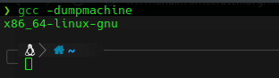
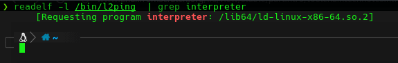

# Cross Compiling Sources

> [!NOTE]
> Those screenshot are from my personnal computer

<div align="center">
  
</div>


```bash
gcc -dumpmachine
```

<br>

<div align="center">
  
</div>


```bash
readelf -l <name of binary> | grep interpreter
```

## [Ressource for this part](https://www.linuxfromscratch.org/lfs/view/stable/partintro/toolchaintechnotes.html)

