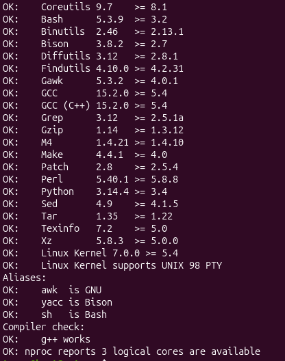

# Preparing the Host System

## Host system requirements

I used this script from the manual to verify if my host system has all the requirements.

```bash
cat > version-check.sh << "EOF"
#!/bin/bash
# A script to list version numbers of critical development tools

# If you have tools installed in other directories, adjust PATH here AND
# in ~lfs/.bashrc (section 4.4) as well.

LC_ALL=C 
PATH=/usr/bin:/bin

bail() { echo "FATAL: $1"; exit 1; }
grep --version > /dev/null 2> /dev/null || bail "grep does not work"
sed '' /dev/null || bail "sed does not work"
sort   /dev/null || bail "sort does not work"

ver_check()
{
   if ! type -p $2 &>/dev/null
   then 
     echo "ERROR: Cannot find $2 ($1)"; return 1; 
   fi
   v=$($2 --version 2>&1 | grep -E -o '[0-9]+\.[0-9\.]+[a-z]*' | head -n1)
   if printf '%s\n' $3 $v | sort --version-sort --check &>/dev/null
   then 
     printf "OK:    %-9s %-6s >= $3\n" "$1" "$v"; return 0;
   else 
     printf "ERROR: %-9s is TOO OLD ($3 or later required)\n" "$1"; 
     return 1; 
   fi
}

ver_kernel()
{
   kver=$(uname -r | grep -E -o '^[0-9\.]+')
   if printf '%s\n' $1 $kver | sort --version-sort --check &>/dev/null
   then 
     printf "OK:    Linux Kernel $kver >= $1\n"; return 0;
   else 
     printf "ERROR: Linux Kernel ($kver) is TOO OLD ($1 or later required)\n" "$kver"; 
     return 1; 
   fi
}

# Coreutils first because --version-sort needs Coreutils >= 7.0
ver_check Coreutils      sort     8.1 || bail "Coreutils too old, stop"
ver_check Bash           bash     3.2
ver_check Binutils       ld       2.13.1
ver_check Bison          bison    2.7
ver_check Diffutils      diff     2.8.1
ver_check Findutils      find     4.2.31
ver_check Gawk           gawk     4.0.1
ver_check GCC            gcc      5.4
ver_check "GCC (C++)"    g++      5.4
ver_check Grep           grep     2.5.1a
ver_check Gzip           gzip     1.3.12
ver_check M4             m4       1.4.10
ver_check Make           make     4.0
ver_check Patch          patch    2.5.4
ver_check Perl           perl     5.8.8
ver_check Python         python3  3.4
ver_check Sed            sed      4.1.5
ver_check Tar            tar      1.22
ver_check Texinfo        texi2any 5.0
ver_check Xz             xz       5.0.0
ver_kernel 5.4

if mount | grep -q 'devpts on /dev/pts' && [ -e /dev/ptmx ]
then echo "OK:    Linux Kernel supports UNIX 98 PTY";
else echo "ERROR: Linux Kernel does NOT support UNIX 98 PTY"; fi

alias_check() {
   if $1 --version 2>&1 | grep -qi $2
   then printf "OK:    %-4s is $2\n" "$1";
   else printf "ERROR: %-4s is NOT $2\n" "$1"; fi
}
echo "Aliases:"
alias_check awk GNU
alias_check yacc Bison
alias_check sh Bash

echo "Compiler check:"
if printf "int main(){}" | g++ -x c++ -
then echo "OK:    g++ works";
else echo "ERROR: g++ does NOT work"; fi
rm -f a.out

if [ "$(nproc)" = "" ]; then
   echo "ERROR: nproc is not available or it produces empty output"
else
   echo "OK: nproc reports $(nproc) logical cores are available"
fi
EOF

bash version-check.sh
```

I've got many `ERROR` with this checker so i had to make some adjustements.


> This as fix the versoin problem for coreutils (it was from uutils packages and not gnu).
```bash
sudo apt install --allow-remove-essential coreutils-from-gnu coreutils-from-uutils-
```

> `bison gawk m4 texi2any` where reported missing by the script so i downloaded them.
```bash
sudo apt install bison gawk m4 texinfo
```

> my sh was not symlinked to bash 
```bash
sudo ln -sf bash /bin/sh && ls -l /bin/sh
```

> You should have 0 ERROR to continue on this.
<div align="center">
  
</div>

## Creating Partitions

[Chapter02 : Creating Partition](https://www.linuxfromscratch.org/lfs/view/stable/chapter02/creatingpartition.html)

Creating the partitions is often done with two main tools : [cfdisk](https://fr.wikipedia.org/wiki/Cfdisk) and [fdisk](https://fr.wikipedia.org/wiki/Fdisk), the main difference beetween them is graphical.

> [!NOTE]
> In my case i will use `Fdisk`.

Here you can find the [Fdisk man](https://man.archlinux.org/man/fdisk.8.en).

The first parameter i used is `-l`, this will **list all partitions** already on your **host system**.
```bash
sudo fdisk -l # you can try this without risk on your personal laptop for education purpose.
```

> You will see many `/dev/loopX`, those are packages mounted like virtual disk by linux to use them without decompressing them.
<div align="center">
  
</div>

> This is the interesting part, you will see two partitions made on the virtual disk.
- `/dev/sda1` of 1MB is the partition needed to host the boot.
- `/dev/sda2` of 25GB is the partition for the root directory (where all will be stocked).
<div align="center">
  
</div>

The next step will be to create our personal partitions for our distribution. 

> [!CAUTION]
> School subject :  
> You must use at least 3 different partitions: root, /boot and a swap partition. You
> can, of course, make more partitions if you want to.


### Partitions Explanation

> [!WARNING]
> You have the choice for the size of each partition, but you have to refer to the tutorial to see the minimum required

- **root** - *35go* : This will contain all the linux file system, this is the only mandatory partition for linux to work. (common format : ext4, btrfs, xfs)
- **/boot** - *1go* : Contain all the files necessary for starting the system. Nowadays the main reasons to separate it from root is to load the program who ask the disk password if the root partition is encrypted, and if you use complex storage like RAID for servers  
- **swap** - *4go* : This partition is not a naviguable memory but will act like an extension of your RAM on the disk. The RAM in case of overflow will move temporary inactive data into this partition to avoid the system to freeze. In case of system hibernation it can also move all the RAM content into it, so the system at the awakening will load it in the RAM from this partition.

---

To facilitate the export of my LFS and the developpement practicity, i will create a new virtual disk attached to my host system.

<div align="center">
  
</div>

<div align="center">
  
</div>

Finally we can create partitions, i used [this](https://doc.ubuntu-fr.org/fdisk) tutorial explaning how to use fdisk utilities.

List all partitions with `sudo fdisk -l` 

> [!CAUTION]
> our new virtual disk must be /dev/sdb but it is possible to have another name if you have already more vdisk, in my tutorial i will assume you have `sdb` but adapt it to your case.

<div align="center">
  
</div>

Next step is to enter edit mode with `fdisk` using ```sudo fdisk /dev/sdb```

To be secure with my new virtual disk the first thing i do is just `o` it will 
create a new fresh [MBR DOS table.](https://en.wikipedia.org/wiki/Master_boot_record)
<div align="center">
  
</div>

### Creating /boot partition

> [!WARNING]
> On my screenshots i forgot to add the `G` after end size sector
> Ex: +1G

```bash
# in fdisk console
n -> new partition
p -> primary partition
1 -> first partition
ENTER -> default first sector
+1G -> 1go Partition
a -> make the partition bootable
```
<div align="center">
  
</div>

### Creating swap partition

> [!WARNING]
> On my screenshots i forgot to add the `G` after end size sector
> Ex: +4G

```bash
# in fdisk console
n -> new partition
p -> primary partition
2 -> second partition
ENTER -> default first sector
+4G -> 4go Partition

t -> change type of partition
2 -> second partition
82 -> linux swap hex code
```
<div align="center">
  
</div>

### Creating root partition

```bash
# in fdisk console
n -> new partition
p -> primary partition
3 -> third partition
ENTER -> default first sector
ENTER -> fill the rest of vdisk
```
<div align="center">
  
</div>

### Exit fdisk console

to clean escape from fdisk console enter `w`

## Creating a file system 

> [!TIP]
> If you dont understand why those partitions need to be formated please read the chapter02 link below.

[Chapter02 : Creating a file system](https://www.linuxfromscratch.org/lfs/view/stable/chapter02/creatingfilesystem.html) 


Normaly the "name" of each partition will follow the order we make them. 

We can take a look again with `sudo fdisk -l` to make sure.
<div align="center">
  
</div>

We want /boot and /root to be in the last version of ext `4`, the first thing to do is using [mkfs](https://linux.die.net/man/8/mkfs).

> [!CAUTION]
> Dont forget to change numbers if your boot/root is different

```bash
sudo mkfs -v -t ext4 /dev/sdb1
sudo mkfs -v -t ext4 /dev/sdb3
```

```
-V
Produce verbose output, including all file system-specific commands that are executed. Specifying this option more than once inhibits execution of any file system-specific commands. This is really only useful for testing.

-t fstype
Specifies the type of file system to be built. If not specified, the default file system type (currently ext2) is used.
```

Next step is to make the swap partiton swapable with [mkswap](https://manpages.ubuntu.com/manpages/trusty/man8/mkswap.8.html)

```bash
sudo mkswap /dev/sdb2
```

[Comparison_of_file_systems](https://en.wikipedia.org/wiki/Comparison_of_file_systems)

## Setting LFS variable and umask

[Chapter02 : LFS VAR/UMASK](https://www.linuxfromscratch.org/lfs/view/stable/chapter02/aboutlfs.html)


To ease ourself, we make a env variable pointing the directory we want our LFS to be mounted.
```bash
export LFS=/mnt/lfs
```

And set the mode creation mask to `022`
```bash
umask 022
``` 
> Setting the umask to 022 ensures that newly created files and directories are only writable by their owner, but are readable and searchable (only for directories) by anyone

## Mounting the new root partition

[Chapter02 : Mounting the New Partition](https://www.linuxfromscratch.org/lfs/view/stable/chapter02/mounting.html)

First we will need to create a directory where the LFS will be located.

> `-p` will create all parents directories
> `-v` verbose mode for more outputs

```bash
sudo mkdir -pv $LFS
```

Next we will mount the `/root` partition of `35go` into the new LFS directory.
```bash
sudo mount -v -t ext4 /dev/sdb3 $LFS
```

You can verify the mountpoint with this command : 
```bash
mountpoint $LFS
```

This will change the owner of LFS for the user `root`
```bash
sudo chown root:root $LFS
sudo chmod 755 $LFS #rwxr-xr-x
```

The command sudo `/sbin/swapon` enables swap space (virtual memory) on a Linux system using root privileges.
```bash
sudo /sbin/swapon -v /dev/sdb2
```

# Next part : [Installing Sources](./lfspackages.md)
