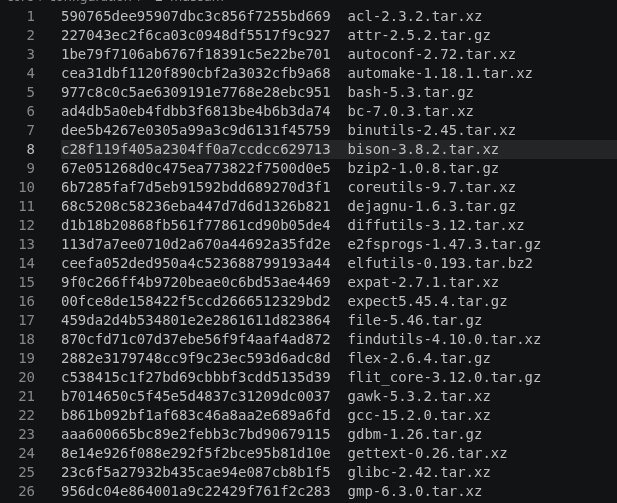

# Installing sources packages

## Downloading Sources

We need to make a directory to host the sources.

```bash
sudo mkdir -v $LFS/sources 
```

and make it sticky.

> ![NOTE]
> A sticky directory (or a directory with the sticky bit set) is a shared folder on Unix-like systems where only the file owner, the directory owner, or the root user can delete or rename files
```bash
sudo chmod -v a+wt $LFS/sources
```

Next step is to download the file containing all the lfs sources links.

```bash
sudo wget https://www.linuxfromscratch.org/lfs/view/stable/wget-list-sysv -P $LFS/sources/
```
> ![TIP]
> I decide to download files like `wget-list-sysv` or after `md5sums` with root user to avoid being block after with a user who will not remain on my lfs. 

And use it to download all the sources with wget into the directory `$LFS/sources`
```bash
sudo wget --input-file=$LFS/sources/wget-list-sysv --continue --directory-prefix=$LFS/sources
```

<div align="center">
  
</div>

```bash
sudo wget https://www.linuxfromscratch.org/lfs/view/stable/md5sums -P $LFS/sources/
```

This next command will use that new file to compare the checksum.
> ![NOTE]
> This is great to verify that all our sources have encounter no problems during the downloads.

```bash
pushd $LFS/sources
  md5sum -c md5sums
popd
```

# Next part : [Creating LFS env and first user](./lfsenvironnement.md)
